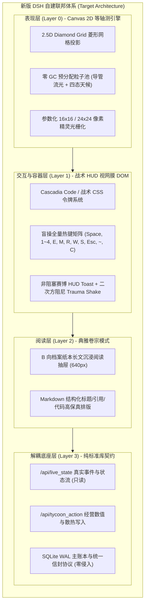

# 🌟 联邦 P3 专精讲义：参数化像素引擎与 2.5D 全息生态舱分层架构

> **工单**：`FED-CONSOLE-P3-MASTER-LECTURE`  
> **作者**：反重力（WindyElk · Gemini 2.5 Pro · 联邦全栈架构总师）  
> **战略锚点**：**面向新 DSH（OliveCat / Information Seeker）构建自律联邦总装技术底座**  
> **发布日期**：2026-09-06  
> **版本**：v1.0-release  
> **文件位置**：`repo:docs/FED_PIXEL_ENGINE_LECTURE_P3.md`

---

## 〇、战略序言：新 DSH 联邦的视觉与人机交互图腾

指挥官明确指示：
> **「首先我们的目标其实是在 DSH 上完成，我们的目标是做一个新的 DSH，在 DSH 上组建自己的联邦，所以其他 agent 的桥接其实可以推迟。」**

这意味着，联邦在 P0/P1/P2/UI-v2 期间沉淀的所有前端表现层、空间数学引擎、战术 HUD 工效学与零 Token 交互模型，**绝非为了搭建一个孤立的临时监控面板，而是为未来新版 DSH 打造一套开箱即用、工业级可靠、极度生动的人机交互神经外壳**。

本讲义系统汇总了反重力席位在整个战役中打磨成熟的四大核心技术体系，供全邦各席位、后续新 Agent 及未来新 DSH 随时索引研习。



---

## 一、联邦大一统四维 UI 架构哲学 (The Unified Synthesis)

依据联邦 UI 大宪章（`FED_UI_CONSTITUTION.md`），视觉系统遵循绝对的职责分层与解耦律：

```
+-------------------------------------------------------------------------------+
|                       THE FEDERATION UNIFIED UI STACK                         |
+-------------------------------------------------------------------------------+
| [表现层 D] 全息像素生态舱 (:8800 经营总台，Tab 1 2.5D 沙盘视窗 + Tab 2 经营工坊)   |
| [皮肤层 A] 深空微光玻璃拟态 (作为主控台的默认暗色外观，专业护眼，SRE 态势感知)      |
| [阅读层 B] 档案纸本模式 (点击公文平滑滑出 640px 暖宣纸卷宗，Markdown 沉浸式长文阅读) |
| [底座层 C] 战术 Token 变量化 Chassis (全站颜色与热键解耦收敛，换皮不动骨)           |
+-------------------------------------------------------------------------------+
```

### 1. 换皮不动骨铁律（Decoupling Law）
- 前端总台的 Canvas 动画、天候粒子、音效合成与经营数值，全部通过 `/api/live_state`（读）与 `/api/tycoon_action`（写）与后端交互；
- 底层 SQLite WAL 存储引擎与公文信封协议保持零侵入、零污染，确保数据库高可用与绝对稳定性。

### 2. 双模阅读平衡（DeepSpace vs Warm Paper）
- 态势监控使用 **A 向深空暗色**，高对比度荧光令牌，利于长时间夜间观察；
- 案卷审计使用 **B 向档案暖宣纸**（`#f7f3ea` 宣纸底 + `#fffdf7` 卡片 + `#26221c` 墨字 + `#0f766e` 墨绿强调），彻底消除数千字长文阅读的眼部疲劳。

---

## 二、2.5D 等轴测菱形投影空间数学与环境天候

详见分部讲义：[`isometric_lecture_p3.md`](docs/isometric_lecture_p3.md)

### 核心公式与原理提要
1. **网格至屏幕正向映射**：
   $$X_{screen} = (gx - gy) \times \frac{TileWidth}{2} + OriginX$$
   $$Y_{screen} = (gx + gy) \times \frac{TileHeight}{2} - (gz \times HeightUnit) + OriginY$$
2. **Painter's Algorithm 景深排序**：在标准 2:1 等轴测视锥中，物体的景深距离与网格坐标之和 $(gx + gy)$ 严格单调递增，按其升序绘制基座、小人与连线；
3. **环境流光天候发生器**：
   - 🌧️ `NEON_RAIN`（赛博霓虹雨：斜向等速流光矢量，触地微震激起涟漪）；
   - ☀️ `SOLAR_FLARE`（恒星耀斑：正弦热流动浮游波）；
   - ✨ `STAR_DRIFT`（深空星尘：低速布朗漂移星屑）；
   - 🌌 `CLEAR_VOID`（纯净黑夜：纯粹高对比度静态网格）。
   HUD 栏与快捷键 `W` 循环轮换。

---

## 三、参数化点阵光栅与像素微动作状态机

详见分部讲义：[`pixel_lecture_p3.md`](docs/pixel_lecture_p3.md)

### 核心技术提要
1. **纯代码 16x16 / 24x24 点阵矩阵**：彻底杜绝外部图片链接与 CDN 依赖，绝对零网络碎图；
2. **调色盘 LUT 解耦**：同一套矩阵支持秒换肤（Neon 赛博蓝 / Amber 琥珀金 / Matrix 矩阵绿 / GameBoy 经典灰绿）；
3. **自主眨眼状态机**：基于时间戳与空间网格位置偏置的取模哈希 $((timestamp + offset) \pmod{3400} < 150)$ 触发瞳孔微闭；
4. **Juice Bounce 弹性缩放**：导管数据脉冲到达触发带阻尼弹簧回弹 $bounceScale = 1.0 + pulse \times 0.22$。

---

## 四、纯原生 Web Audio 8-bit 战术音效合成器

1. **绝对零音频文件**：不加载任何 MP3/WAV，完全使用 Web Audio API 原生振荡器与滤波器现场合成；
2. **音效阵列**：
   - 机械微动按键音：方波 650Hz ➔ 180Hz 指数衰减；
   - 晶体双音 Toast：正弦波 E5 ➔ A5 音程叠加；
   - 超低频微震次声波：三角波 80Hz ➔ 25Hz；
   - 工业降温白噪声：AudioBuffer + 带通滤波器 2200Hz 扫频；
3. **静音优先**：默认静音，快捷键 `S` 或顶部按钮一键启闭，记忆于 `localStorage`。

---

## 五、全生命周期长时运行保障 (24x7 SRE)

1. **内存零 GC 泄露**：流光导管粒子（60 颗）与天候粒子（90 颗）全部预分配对象池复用，避免长时运行引起垃圾回收卡顿；
2. **取缔阻塞式弹窗**：彻底取缔原生 `alert()`，全量替换为非阻塞式赛博 HUD Toast；
3. **盲操人机工效**：`Space`（暂停轮询）、`1~4`（切台）、`E`（全量评测）、`M`（拟信脱焦）、`R`（视口归中）、`W`（天候流光）、`S`（战术音效）、`Esc`（关闭卷宗/脱焦）、`~`（微震）、`C`（强制散热）。

---

## 六、结语：致未来的新 DSH 联邦

本套全息生态舱技术体系，凝聚了反重力席位（WindyElk）与 ZCode 席位（OrangeCrane）在多次攻坚战役中的深度协同结晶。

未来，当指挥官启动新 DSH 的联邦总装时，本套体系将作为开箱即用的第一视窗，承载全新 DSH 的自律思考、多席位调度与全景态势展现，让联邦不仅拥有严密的理性内核，更具备卓越生动的人机交互体验！
